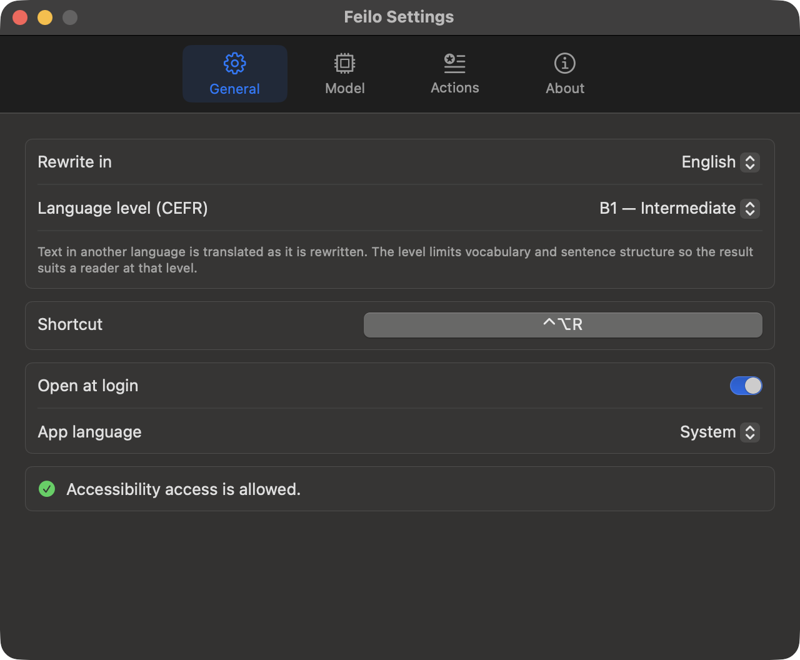
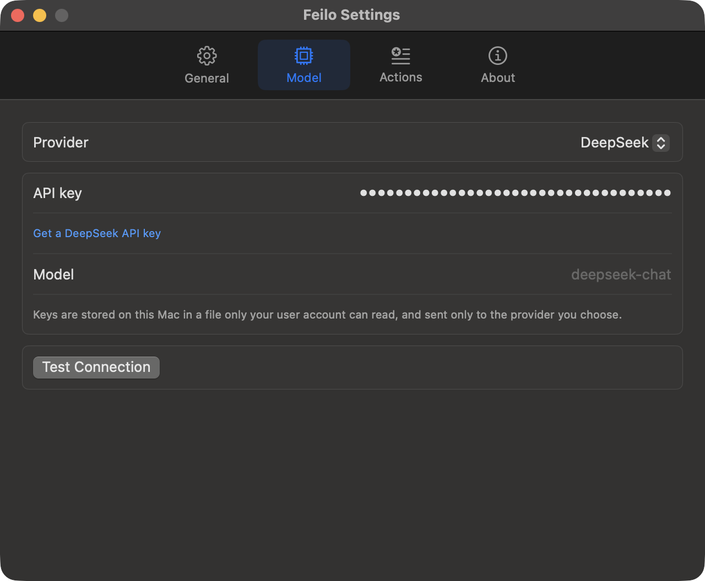
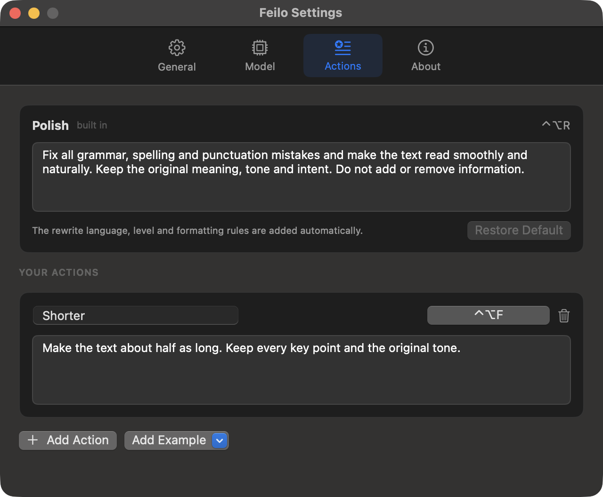

<p align="center"></p>

<h1 align="center">Feilo</h1>

<p align="center">
<a href="README.md">English</a> · Deutsch
</p>

Dieses Repository enthält die signierten Release-Builds von Feilo und das
Installationsskript. Der Quellcode ist privat.

Markiere Text in einer beliebigen App, drücke **⌃⌥R**, und Feilo ersetzt ihn
durch eine geschliffene Fassung: Grammatik, Rechtschreibung und Zeichensetzung
sind korrigiert, Sätze geglättet, der Sinn bleibt erhalten. Feilo funktioniert
in Mail, Chat, Browsern, Editoren und Office-Apps und lässt Fett, Kursiv und
Links dort, wo sie waren.

*Feilo* kommt vom deutschen *feilen*: etwas so lange bearbeiten, bis es glatt ist.



## Installation

Mit [Homebrew](https://brew.sh):

```bash
brew install --cask xiaoyuhen/tap/feilo
```

Oder mit einer Zeile im Terminal:

```bash
curl -fsSL https://raw.githubusercontent.com/xiaoyuhen/feilo-releases/main/install.sh | bash
```

Oder lade `Feilo-x.y.z.zip` von
[Releases](https://github.com/xiaoyuhen/feilo-releases/releases) herunter,
entpacke die Datei und ziehe `Feilo.app` in den Ordner „Programme“. Feilo ist
signiert, aber **nicht notarisiert**, deshalb wird ein Download per Browser
beim ersten Mal blockiert. Führe entweder einmalig
`xattr -dr com.apple.quarantine /Applications/Feilo.app` aus, oder öffne die
App, schließe die Warnung und klicke in Systemeinstellungen → Datenschutz &
Sicherheit auf **Trotzdem öffnen**. Bei Homebrew und beim Installationsskript
wird das automatisch erledigt.

Voraussetzung ist macOS 14 (Sonoma) oder neuer, auf Apple Silicon oder Intel.

### Erster Start

1. Feilo erscheint in der Menüleiste und öffnet seine Einstellungen.
2. macOS fragt nach dem Zugriff auf **Bedienungshilfen**. Erlaube ihn in
   Systemeinstellungen → Datenschutz & Sicherheit → Bedienungshilfen. Feilo
   braucht ihn, um den markierten Text zu kopieren und das Ergebnis wieder
   einzufügen. Die Berechtigung bleibt bei Updates erhalten.
3. Ab jetzt startet Feilo bei der Anmeldung. Das kannst du in
   Einstellungen → Allgemein ausschalten.

## Benutzung

| | |
|---|---|
| **Überarbeiten** | Markiere Text und drücke **⌃⌥R**. Neben dem Zeiger erscheint eine kleine „Überarbeiten …“-Blase; sobald sie verschwindet, ist der Text ersetzt. Drücke das Tastenkürzel noch einmal, um abzubrechen. |
| **Eigene Aktionen** | Einstellungen → Aktionen: Füge Anweisungen wie „förmlicher“, „kürzer“ oder „nur übersetzen“ hinzu, jeweils mit eigenem Tastenkürzel. Sie erscheinen auch im Menü in der Menüleiste. |
| **Sprache** | Formuliere auf **Englisch** (Standard) oder **Deutsch** um. Text in jeder anderen Sprache wird beim Umformulieren übersetzt. |
| **Niveau** | Halte das Ergebnis auf einem CEFR-Niveau: A1, A2, B1, B2, **C1** (Standard), C2 oder ohne Begrenzung. Feilo teilt dem Modell mit, welchen Wortschatz und welche Satzstrukturen das Niveau erlaubt. |
| **Formatierter Text** | Fett, Kursiv, Unterstrichen, Links, Schriften und Farben bleiben an den richtigen Wörtern, auch wenn ein Satz umgestellt oder übersetzt wird. |

Nach jedem Umformulieren wird deine Zwischenablage wieder so hergestellt, wie
sie war. Wenn du die App wechselst, während eine Umformulierung noch lädt,
wird nichts eingefügt.

## Modelle

Wähle in Einstellungen → Modell einen Anbieter:

| Anbieter | Schlüssel |
|---|---|
| **Kostenlos (integriert)** | Keiner. 25 Umformulierungen pro Tag, je bis zu 2.000 Zeichen, mit einem offenen Modell (Mistral Small 3.1) auf Cloudflare Workers AI. |
| OpenAI, Anthropic, Google Gemini, DeepSeek, Groq, OpenRouter, Mistral | Dein eigener API-Schlüssel. Gemini, Groq und OpenRouter haben eigene kostenlose Kontingente. |
| Ollama | Keiner; läuft lokal, nichts verlässt deinen Mac. |
| Benutzerdefiniert | Jeder OpenAI-kompatible Endpunkt (LM Studio, ein Firmen-Proxy, …). |

Der Modellname lässt sich bearbeiten, und mit **Verbindung testen** prüfst du
Schlüssel und Modell vor der ersten echten Umformulierung. Schlüssel werden in
`~/Library/Application Support/Feilo/credentials.json` gespeichert, sind nur
für dein Benutzerkonto lesbar und werden ausschließlich an den Anbieter
gesendet, zu dem sie gehören.





## Updates

Feilo sucht einmal am Tag nach einer neuen Version (Einstellungen → Info →
*Automatisch nach Updates suchen*) oder immer dann, wenn du im Menü
**Nach Updates suchen…** wählst. Ein Update wird von GitHub geladen und nur
installiert, wenn die Prüfsumme stimmt und es mit dem eigenen Zertifikat von
Feilo signiert ist. Danach startet Feilo neu. Wer Homebrew nutzt, kann
außerdem `brew upgrade --cask feilo` ausführen.

## Datenschutz

Markierter Text geht nur an den Anbieter, den du gewählt hast. Mit deinem
eigenen Schlüssel läuft er direkt von deinem Mac zu diesem Anbieter; im
kostenlosen Tarif läuft er über Feilos Cloudflare Worker, der ihn nicht
speichert.

Feilo sendet außerdem anonyme Tageszahlen (Starts und Umformulierungen pro
Anbietertyp). Der kostenlose Tarif zählt Anfragen pro Installation (eine
zufällige UUID) und pro Netzwerk (ein SHA-256-Hash der IP-Adresse, vermischt
mit einem Geheimnis, das sich täglich ändert, niemals die IP selbst), um das
Tageslimit durchzusetzen. Diese Zähler werden nach zwei Tagen gelöscht. Die
anonymen Zahlen enthalten niemals Text, Prompts, Schlüssel, Modellnamen oder
App-Namen. Du kannst sie in Einstellungen → Info ausschalten oder indem du
`FEILO_NO_TELEMETRY=1` setzt.
